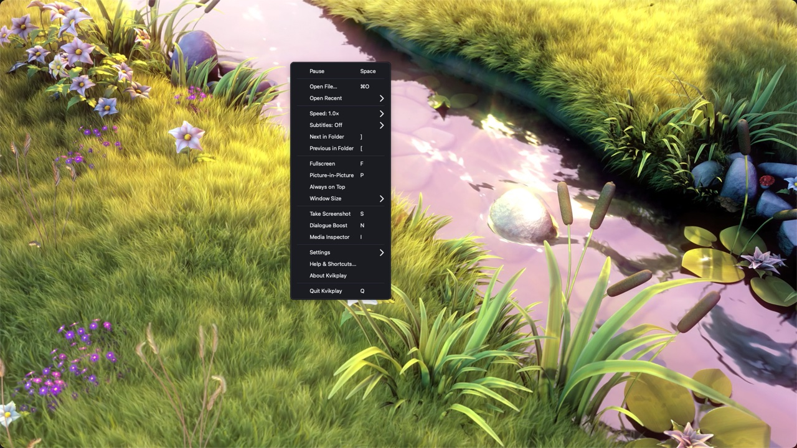
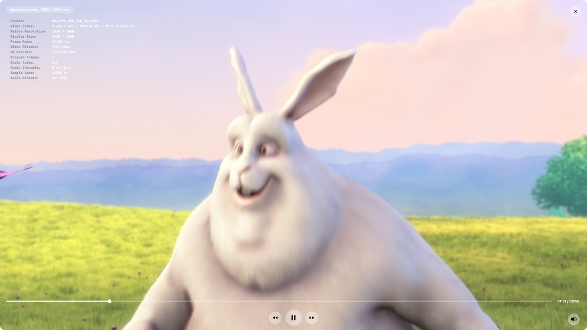

# Kvikplay

> A fast, lightweight, frameless video and audio player for macOS and Windows.

**Version 1.2.0** · [Changelog](CHANGELOG.md) · [Security](SECURITY.md) · [Download](https://github.com/jozeta/kvikplay/releases/latest)

Kvikplay is for people who want a video to open instantly and then get out of the way. There is no
title bar, toolbar or playlist: the video fills a rounded, borderless window that keeps the video's
exact aspect ratio, and the controls only appear while you move the mouse. Playback is done by
[libmpv](https://mpv.io) (the engine behind mpv), so it plays practically anything, with hardware
decoding and HDR tone mapping. The interface is Qt 6.

---

## Contents

- [Screenshots](#screenshots)
- [What's new](#whats-new)
- [Features](#features)
- [macOS and Windows](#macos-and-windows)
- [Installation](#installation)
- [How to](#how-to)
- [Keyboard shortcuts](#keyboard-shortcuts)
- [Mouse and trackpad](#mouse-and-trackpad)
- [Settings](#settings)
- [Supported formats](#supported-formats)
- [Building from source](#building-from-source)
- [Technology](#technology)

---

## Screenshots

<table>
  <tr>
    <td align="center" width="33%"><br><sub>Playback with the overlay: file name, timeline, time, controls and volume</sub></td>
    <td align="center" width="33%"><br><sub>Right-click-and-hold menu, grouped by task, with shortcuts</sub></td>
    <td align="center" width="33%"><br><sub>Media inspector (<code>I</code>): codecs, resolution, bitrates, hardware decoder</sub></td>
  </tr>
</table>

<sub>Video: <em>Big Buck Bunny</em> © Blender Foundation, CC BY 3.0.</sub>

---

## What's new

### 1.2.0 (2026-11-21)

- **New on-screen controls ("cinematic"):** no boxes, just soft shading at the top and bottom.
  The title sits top left, a full-width timeline with chapter ticks shows elapsed time on the
  left and remaining time on the right (click it for the total), and the controls are clean white
  glyphs: play, back and forward 10 s, volume, subtitles and fullscreen.
- **Centre messages:** volume shows as a ring, other messages as a small dark capsule.
- **Hover preview:** a rounded frame with the time and chapter name.
- **Subtitles button** opens the subtitle choices right above it.
- The title comes from the file's metadata when it has one.

### 1.1.0 (2026-11-21)

- **Automatic updates:** Kvikplay looks for a new version when it starts and offers to install
  it. Turn it off in About.
- **Redesigned right-click menu**, grouped by task, with speed, chapters, next/previous file,
  window size and subtitle timing.
- **Opening from Finder/Explorer:** replace the current video or open a new window.
- **Windows parity:** media keys and the media flyout, one player window, HiDPI-correct resizing.
- **Fixes:** no more black window at launch, real timeline thumbnails, replay after the end,
  reliable screenshots, multi-monitor restore, and many more.
- **Security and speed:** media metadata shown as plain text only, hardened libmpv, fewer threads
  and less memory.
- **Signed and notarized** macOS release.

Older and upcoming changes: [CHANGELOG.md](CHANGELOG.md).

---

## Features

**Window**
- Frameless window with rounded corners and a system shadow. It locks to the video's display
  aspect ratio, including anamorphic (non-square pixel) video.
- A newly opened video sizes the window to its native size, shrunk to fit at most 85 % of the
  screen. The window always stays inside the visible screen area (menu bar, Dock and taskbar
  excluded).
- Drag anywhere to move. Resize from any edge (16 px zone) or corner (32 px zone).
- Fullscreen (double-click or `F`) keeps the aspect ratio on black and hides the cursor after
  5 seconds without movement.
- Picture-in-picture (`P`): a 380 px wide always-on-top mini player in the bottom-right corner.
- Window scale shortcuts: `1` = 100 %, `2` = 50 %, `4` = 25 % of the video's size.

**Playback**
- Starts playing as soon as a file opens, and resumes where you left off (remembered for the last
  100 files, when you stopped more than 5 s from the start and the end).
- Plays the next file in the folder when one ends. `]`/`[` and PageDown/PageUp move through the
  folder in natural order (`Episode 2` before `Episode 10`).
- Hold `C` (or hold the ⏩ button) for 2× speed; release to go back. A short tap on ⏩ skips 10 s. Speed steps of ±0.1× from
  0.25× to 4×, with pitch correction.
- Frame stepping, ±10 s / ±30 s seeking, chapter jumps with chapter ticks on the timeline.
- Audio, video and subtitle track selection. Subtitles next to the video are found automatically;
  drop a subtitle file on the window to add it. Subtitle delay in 100 ms steps.
- Dialogue boost: dynamic audio normalisation (`dynaudnorm`) that lifts quiet speech.

**Overlay**
- Appears on mouse movement (also while another app is in front), fades out after 5 seconds.
  No boxes: soft shading at the top and bottom keeps it readable on any picture.
- Top: the title (from the file's metadata, else the file name) and the close button.
- Bottom: a full-width timeline with chapter ticks and a frame preview on hover; elapsed time on
  the left, remaining time on the right (click it to show the total length); play/pause, back
  and forward 10 s on the left; volume, subtitles and fullscreen on the right. In a small window
  only play/pause, volume and fullscreen stay.
- Short messages in the middle of the picture for every action: the volume as a ring, others
  (`+10s`, `Speed 1.5x`, …) as a small dark capsule.
- Media inspector (`I`): container, codecs, resolution, frame rate, bitrates, hardware decoder,
  dropped frames, audio channels and sample rate, updated twice a second.

**Other**
- Screenshot (`S`, or `Shift+S` with subtitles) saved to the Desktop as `Kvikplay_<date>_<time>.png`
  and copied to the clipboard.
- Recent files (last 8) in the right-click menu.
- File associations dialog for every supported format.
- Keeps the display awake while playing.

---

## macOS and Windows

Kvikplay aims for the same features on both systems, adapted to each OS. Current state:

| Feature | macOS | Windows |
|---|---|---|
| Frameless rounded window, shadow | ✅ Cocoa layer, 14 px radius | ✅ DWM rounding (Windows 11; square on Windows 10) |
| Aspect-locked resizing | ✅ `NSWindow setAspectRatio` | ✅ `WM_SIZING` |
| Hardware decoding | ✅ VideoToolbox | ✅ `auto-safe` (D3D11/DXVA2 with a working OpenGL path, else copy-back) |
| Open a file from Finder / Explorer while running | ✅ Replaces the video, or a new window (menu choice) | ✅ Same: a second launch hands the file over, or opens a new window |
| Now Playing and media keys | ✅ Control Center, lock screen, media keys | ✅ Media flyout, lock screen, media keys (System Media Transport Controls) |
| Controls appear on hover when the app is in the background | ✅ Own tracking area | ✅ Windows delivers the mouse movement |
| Keep display awake while playing | ✅ IOKit power assertion | ✅ `SetThreadExecutionState` |
| File associations | ✅ Launch Services; to undo, use Finder → Get Info → Open with | ✅ Per-user registry + Windows "Default apps"; unticking removes it |
| Open-file shortcut | `Cmd+O` | `Ctrl+O` |

The Windows-only code is compiled and tested by CI (MSYS2, see `.github/workflows/ci.yml`) but
has not yet been run by hand on a Windows PC.

---

## Installation

### macOS (11 Big Sur or later)

1. Get `Kvikplay-<version>-macOS-arm64.zip` (Apple silicon), or build it yourself (see
   [Building from source](#building-from-source) and [Releasing](#releasing-macos)).
2. Unzip it and drag `kvikplay.app` into `/Applications`.
3. Open it. The release build is signed with a Developer ID and notarized by Apple, so macOS
   opens it without warnings. (A local build without signing is signed ad hoc only: the first
   time, right-click it → **Open** and confirm.)

### Windows (10 or 11, 64-bit)

1. Build with Visual Studio 2022 (see below). The build copies Qt, `mpv-2.dll` and the C++ runtime
   next to `kvikplay.exe` in `build\`.
2. Copy that whole folder wherever you like (for example `C:\Program Files\Kvikplay`) and pin
   `kvikplay.exe` to Start.

Kvikplay needs no installer and writes nothing outside its config file, unless you set up file
associations.

---

## How to

**Open a video.** Drag a file or a folder onto the window, press `Cmd+O` / `Ctrl+O`, right-click and
hold → **Open File…**, or open the file with Kvikplay from Finder/Explorer. A dropped folder starts
with its first media file.

**Play and pause.** `Space`, a quick right-click (or two-finger click), or the play button. When
the window isn't focused, the first click only focuses it.

**Open the menu.** Right-click and hold for half a second (or two-finger click and hold). The
menu is grouped by task:

| Group | Items |
|---|---|
| Playback | Play / Pause |
| File | Open File…, Open Recent |
| What's playing | Speed (shows the current speed), Audio and Video (only when there is more than one track), Subtitles (tracks, Add Subtitle File…, timing), Chapter (only when the file has chapters), Next / Previous in Folder |
| Window | Fullscreen, Picture-in-Picture, Always on Top, Window Size |
| Tools | Take Screenshot, Dialogue Boost, Media Inspector |
| Settings | Reverse Trackpad (Touchpad) Scrubbing, Start in Fullscreen, Opening Files from Finder/Explorer, File Associations… |
| Help | Help & Shortcuts…, About Kvikplay, Quit (Exit on Windows) |

With no video open it shows only Open File, Open Recent, Settings, Help, About and Quit.
Shortcuts are listed next to each item.

**Seek.** Arrow keys (±10 s, with `Shift` ±30 s), scroll wheel, two-finger swipe left/right, or click
and drag on the timeline. Hover the timeline to see a thumbnail.

**Watch a series.** Open the first episode; the next one starts when it ends. Use `]` and `[` to
skip.

**Fix subtitle timing.** Press `Z` if subtitles come too late, `X` if they come too early (100 ms per
press).

**Add a subtitle file.** Drag the `.srt`, `.ass`, `.vtt`, `.ssa`, `.sub` or `.idx` file onto the
window.

**Choose what opening a file from Finder or Explorer does.** Right-click and hold → **Opening Files
from Finder** (Explorer on Windows) → **Replace Current Video** (the default) or **Open in New
Window**. A new window is a separate player with its own playback and volume, placed slightly
offset from the first. Dragging a file onto a window, **Open File…** and **Open Recent** always
replace the video in that window.

**Make Kvikplay the default player.** Right-click and hold → **File Associations…**, tick the
formats, **Save**. On Windows, also confirm in **Settings → Apps → Default apps** (the dialog has a
button for it).

**Take a screenshot.** `S` for the clean frame, `Shift+S` with subtitles. The image goes to the
Desktop and the clipboard.

---

## Keyboard shortcuts

| Shortcut | Action |
|---|---|
| `Cmd+O` / `Ctrl+O` | Open a file |
| `Space` | Play / pause |
| `←` / `→` | Seek −10 s / +10 s |
| `Shift+←` / `Shift+→` | Seek −30 s / +30 s |
| `↑` / `↓` | Volume +5 % / −5 % |
| `M` | Mute / unmute |
| `C` (hold) | 2× speed while held |
| `-` / `=` (or `+`) | Speed −0.1× / +0.1× (0.25×–4×) |
| `Backspace` | Speed back to 1× |
| `.` / `,` | One frame forward / back |
| `]` or `PageDown` | Next file in folder |
| `[` or `PageUp` | Previous file in folder |
| `Shift+]` / `Shift+[` | Next / previous chapter |
| `Z` / `X` | Subtitle delay −100 ms / +100 ms |
| `N` | Dialogue boost on/off |
| `S` / `Shift+S` | Screenshot / screenshot with subtitles |
| `1` / `2` / `4` | Window at 100 % / 50 % / 25 % of video size |
| `P` | Picture-in-picture on/off |
| `I` | Media inspector on/off |
| `F` | Fullscreen on/off |
| `Esc` | Leave fullscreen |
| `Q` | Quit |

The same list is in the app: right-click and hold → **Help & Shortcuts…**.

## Mouse and trackpad

| Action | Result |
|---|---|
| Right-click / two-finger click | Play / pause (window must already be focused) |
| Right-click / two-finger click, held 0.5 s | Menu |
| Double-click | Fullscreen on/off |
| Drag | Move the window |
| Drag an edge or corner | Resize, keeping the aspect ratio |
| Scroll wheel | Seek ±10 s (`Shift` ±30 s) |
| `Ctrl` + scroll wheel | Volume ±5 % |
| Two-finger swipe left/right | Seek ±10 s (`Shift` ±30 s); direction can be reversed in the menu |
| Hover the timeline | Thumbnail preview |
| Click the time | Switch between elapsed and remaining time |
| Hold the ⏩ button | 2× speed while held |

---

## Settings

Settings are changed in the app (menu toggles, volume, window size) and saved to a JSON file:

| OS | File |
|---|---|
| macOS | `~/Library/Preferences/Kvikplay/Kvikplay/config.json` |
| Windows | `%LOCALAPPDATA%\Kvikplay\Kvikplay\config.json` |

| Key | Default | Set by | Meaning |
|---|---|---|---|
| `windowWidth`, `windowHeight` | `960`, `540` | Resizing | Last window size (minimum 160 × 90) |
| `windowX`, `windowY` | `-1`, `-1` (centred) | Moving | Last window position |
| `volume` | `100` | Volume slider, `↑`/`↓` | 0–100 |
| `muted` | `false` | `M`, volume icon | Mute state |
| `alwaysOnTop` | `false` | Menu → Always on Top | Keep the window above others |
| `reverseTrackpadScrubbing` | `false` | Menu → Reverse Trackpad Scrubbing | Swap the swipe-to-seek direction |
| `dialogueBoost` | `false` | Menu → Quiet Dialogue Boost, `N` | Dynamic audio normalisation |
| `playbackSpeed` | `1.0` | `-`, `=`, `Backspace` | Speed applied at start, 0.25–4.0 (the 2× hold is not saved) |
| `startInFullscreen` | `false` | Menu → Start in Fullscreen | Go fullscreen when the app starts |
| `checkForUpdates` | `true` | About → Check for updates when Kvikplay starts | Look for a new version at start |
| `externalOpen` | `"replace"` | Menu → Opening Files from Finder/Explorer | `"replace"` or `"newWindow"`: what opening a file from Finder/Explorer does while a video plays |
| `recentFiles` | `[]` | Opening files; Menu → Open Recent → Clear Recent | Last 8 files |
| `resumePositions` | `[]` | Closing or switching files | `{path, pos}` list, the 100 most recently saved files |
| `associations` | `[]` | File Associations dialog | Extensions you chose to associate |

Quit Kvikplay before editing the file by hand; invalid values fall back to the defaults. Delete the
file to reset everything. The file is written atomically, so a crash can't leave it half-written.

Set the environment variable `KVIKPLAY_CONFIG_DIR` to use another folder for `config.json`
(the tests use this to stay away from your real settings).

Command line: `kvikplay [file]`, `kvikplay --version` prints the version.

Fixed behaviour (not configurable): overlay hides after 5 s; seek steps 10 s / 30 s; volume steps
5 %; demuxer cache 128 MiB / 15 s read-ahead; screenshots go to the Desktop.

---

## Updates

When Kvikplay starts (3 seconds after the window opens, in the background) it asks GitHub for the
latest release of `jozeta/kvikplay`. If there is a newer version you are asked whether to install
it:

- **Install Update** downloads it, checks it, quits Kvikplay, puts the new version in place of the
  old one and starts it again.
- **Not Now** does nothing until the next start.

Before anything is installed the download must match the SHA-256 checksum GitHub publishes for it,
and on macOS the new app must be signed by the same developer and approved by Gatekeeper. If the
app's folder isn't writable, or there is no automatic update for your computer (Windows and Intel
Macs for now: there is no signed build the installer could verify), the download page opens
instead.

Turn the check off, or check right now: right-click and hold → **About Kvikplay** → **Check for
updates when Kvikplay starts** / **Check for Updates…**. The check sends one request to
`api.github.com` with the user agent `Kvikplay/<version>`; nothing else about you or your files.

## Supported formats

Defined in one place, `src/formats/FormatRegistry.cpp`:

- **Common video:** `.mp4` `.m4v` `.mkv` `.avi` `.mov` `.webm`
- **Other video:** `.ogv` `.3gp` `.3g2` `.mts` `.m2ts` `.ts` `.m2v` `.vob` `.mpg` `.mpeg` `.wmv` `.asf` `.flv`
- **Audio:** `.mp3` `.wav` `.flac` `.aac` `.m4a` `.ogg` `.opus` `.wma`
- **Subtitles (drop onto the window):** `.srt` `.ass` `.ssa` `.vtt` `.sub` `.idx`

---

## Building from source

### Requirements

**macOS**
```bash
brew install cmake pkg-config mpv qtbase qtsvg
```

**Windows**
- Visual Studio 2022 (MSVC, C++20)
- Qt 6.5 or later for MSVC 2022 64-bit
- A libmpv development package (`mpv-2.dll`, import library and headers) found through `pkg-config`

### Build

```bash
cmake -B build -DCMAKE_BUILD_TYPE=Release
cmake --build build -j8
```

Every build also packages a standalone app: on macOS `macdeployqt` bundles Qt, libmpv and FFmpeg
into `build/kvikplay.app` and signs it ad hoc; on Windows `windeployqt` and the script in `scripts/`
copy Qt, `mpv-2.dll` and the runtime next to `kvikplay.exe`. Turn this off for quicker development
builds with `-DKVIKPLAY_STANDALONE=OFF`.

### Tests

```bash
ctest --test-dir build --output-on-failure
```

The tests use a `CHECK()` macro that works in every build type, run from the source folder (the
sample clips are in `test_media/`) and use a temporary settings folder. CI runs them on macOS and
Windows for every push.

### Releasing (macOS)

```bash
cmake -B build-release -DCMAKE_BUILD_TYPE=Release
cmake --build build-release --target kvikplay      # standalone app, ad-hoc signed
scripts/sign_notarize_macos.sh                     # Developer ID + Hardened Runtime, notarize, staple
```

The script signs every bundled library inside out, submits the app to Apple's notary service,
staples the ticket, checks it with Gatekeeper and writes
`build-release/Kvikplay-<version>-macOS-arm64.zip`. It needs a "Developer ID Application"
certificate in the keychain (`CODESIGN_IDENTITY` to choose one) and a notarytool keychain
profile (`KVIKPLAY_NOTARY_PROFILE`, default `LadaNotary`).

### Run

```bash
open build/kvikplay.app                                   # macOS
./build/kvikplay.app/Contents/MacOS/kvikplay movie.mkv    # macOS, with a file
.\build\kvikplay.exe movie.mkv                            # Windows
```

---

## License

Kvikplay's source code is released under the [MIT License](LICENSE). The macOS app bundles Qt,
libmpv, FFmpeg and other libraries; some of them are GPL licensed, so the distributed app as a
whole is covered by the GNU GPL version 3. [THIRD_PARTY_NOTICES.md](THIRD_PARTY_NOTICES.md) lists
every bundled library with its licence and source, and the licence texts are inside the app
(`Contents/Resources/licenses/`).

## Technology

- **C++20**, **Qt 6** Widgets (Core, Gui, Widgets, OpenGLWidgets, Svg), **CMake** 3.25+
- **libmpv** 0.35 or later (developed against 0.42), rendered through the mpv OpenGL render API
  into a `QOpenGLWidget`
- **macOS:** Objective-C++ with Cocoa, Launch Services, UniformTypeIdentifiers, MediaPlayer
  (`MPNowPlayingInfoCenter`, `MPRemoteCommandCenter`) and IOKit power assertions
- **Windows:** Win32 (`WM_NCHITTEST`, `WM_SIZING`), DWM, the registry and `SetThreadExecutionState`
